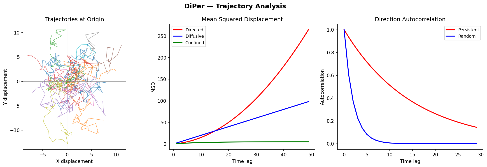
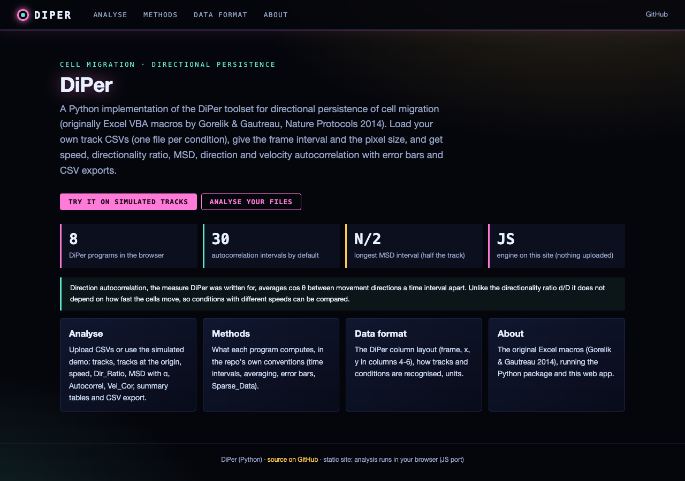
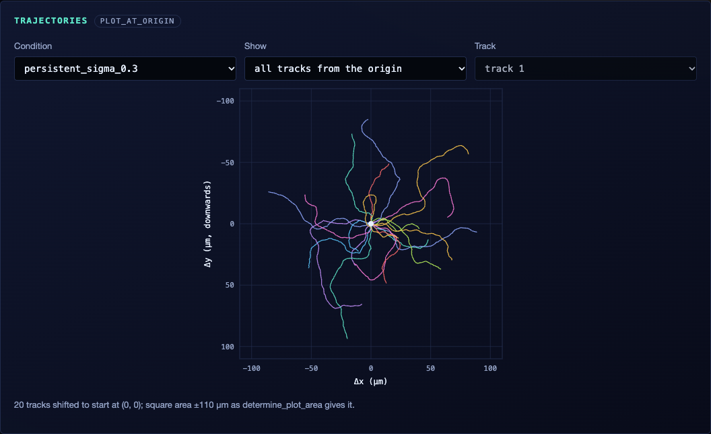
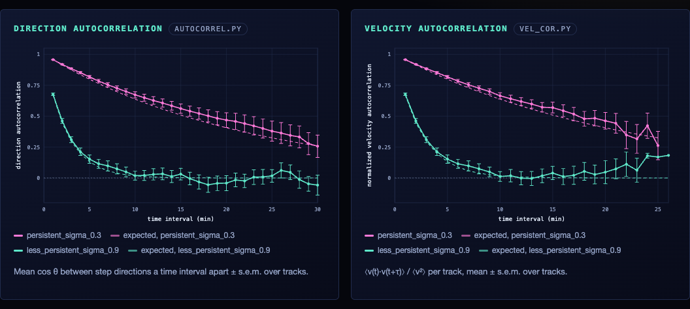
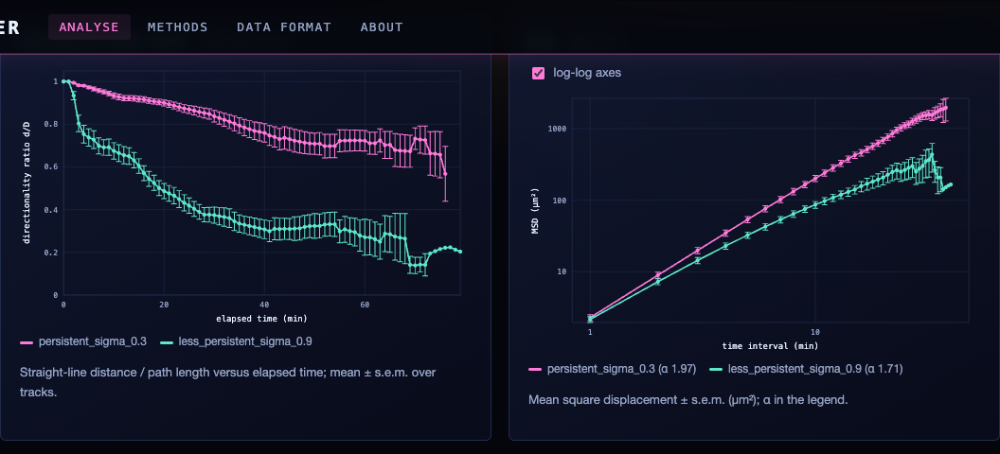

# DiPer Clone



A Python reimplementation of the DiPer (Directional Persistence) toolbox for analyzing cell migration trajectories. Provides direction autocorrelation, mean squared displacement, speed analysis, and other trajectory metrics.

## Features

- **Direction autocorrelation** (2D and 3D) with and without gap handling
- **Mean squared displacement (MSD)** analysis
- **Speed calculation** along trajectories
- **Directionality ratio** analysis
- **Velocity correlation**
- **Trajectory visualization** (plot at origin, sparse data handling)
- **Chart generation** from analysis results
- Modular design with shared utility functions

## Requirements

- Python 3.9+ (pyproject.toml)
- numpy, pandas, matplotlib, seaborn, openpyxl

```bash
pip install -r requirements.txt
```

## Usage

```python
from diper.utils import load_data
from diper.speed import run_speed_analysis
from diper.msd import run_msd_analysis
from diper.autocorrel import run_autocorrelation_analysis

# Excel: one sheet per condition; CSV: one file per condition.
# Columns 4, 5, 6 are frame, x, y (columns 1-3 are free metadata); a new track starts
# wherever the frame number does not increase.
data = load_data("trajectories.xlsx")
speed = run_speed_analysis(data, time_interval=1.0, output_dir="results")
msd = run_msd_analysis(data, time_interval=1.0, output_dir="results")
autocorr = run_autocorrelation_analysis(data, time_interval=1.0, max_intervals=30, output_dir="results")
```

See `docs/usage_example.py` and `docs/diper_user_manual.md` for every analysis.

## Web interface



Live (static) site: https://gddickinson.github.io/diper_clone/ . Analyse your own track CSVs (one file per
condition, DiPer layout: frame, x, y in columns 4-6) in the browser, or try the simulated demo tracks (seeded
persistent random walks, clearly labelled; the repo has no measured data). You give the frame interval, the time
unit, and whether x/y are pixels (pixel size in µm/px required) or µm; every program then runs at once: tracks and
Plot_At_Origin, Speed, Dir_Ratio (over time and last point), MSD with α, Autocorrel (and Autocorrel_3D when a 7th
z column is present), Vel_Cor and optional Sparse_Data, with error bars, a summary table and CSV exports that record
the settings and units.

| Tracks from the origin | Direction and velocity autocorrelation | Dir_Ratio and MSD |
|---|---|---|
|  |  |  |

```bash
pip install -r requirements-web.txt
python run_web.py                     # local app: http://127.0.0.1:8156 (Python engine, Excel accepted)
python scripts/build_static.py        # static site in site/ (published by .github/workflows/pages.yml)
python -m pytest -q tests             # package + web tests (node runs the JS engine test if installed)
```

- **Local app**: uploads go to the local FastAPI server, which calls the package's own functions
  (`diper/web/analysis.py`); for CSV input the page also re-runs the JS port and reports the largest difference.
- **Static site**: `diper/web/static/diper_engine.js` is a JavaScript port of the same steps, checked against the
  Python results on `tests/fixtures/diper_fixture.json` by `diper_engine.test.mjs` (worst relative difference
  about 1e-15; regenerate the fixture with `python scripts/make_diper_fixture.py`). Nothing is uploaded.
- Not in the web pages: Autocorrel_NoGaps (numpy random vectors) and Make_Charts image files (the Analyse page can
  show any single track instead).

## Project Structure

```
diper_clone/
├── diper/
│   ├── __init__.py
│   ├── autocorrel.py          # Direction autocorrelation (2D)
│   ├── autocorrel_3d.py       # Direction autocorrelation (3D)
│   ├── autocorrel_nogaps.py   # Autocorrelation, stops replaced by tiny random vectors
│   ├── dir_ratio.py           # Directionality ratio
│   ├── msd.py                 # Mean squared displacement
│   ├── speed.py               # Speed analysis
│   ├── vel_cor.py             # Velocity correlation
│   ├── plot_at_origin.py      # Origin-centered trajectory plots
│   ├── sparse_data.py         # Sparse data handling
│   ├── make_charts.py         # Chart generation
│   └── utils.py               # Shared utilities
├── data/                      # Your own data (git-ignored; no example data is committed)
└── docs/                      # Documentation
```

## Reference

Based on the DiPer Excel-based toolbox for cell migration analysis: Gorelik, R. & Gautreau, A. (2014). Quantitative
and unbiased analysis of directional persistence in cell migration. Nature Protocols 9(8), 1931-1943.
https://doi.org/10.1038/nprot.2014.131


---
*Built with AI assistance from [Claude (Anthropic)](https://claude.com/).*
